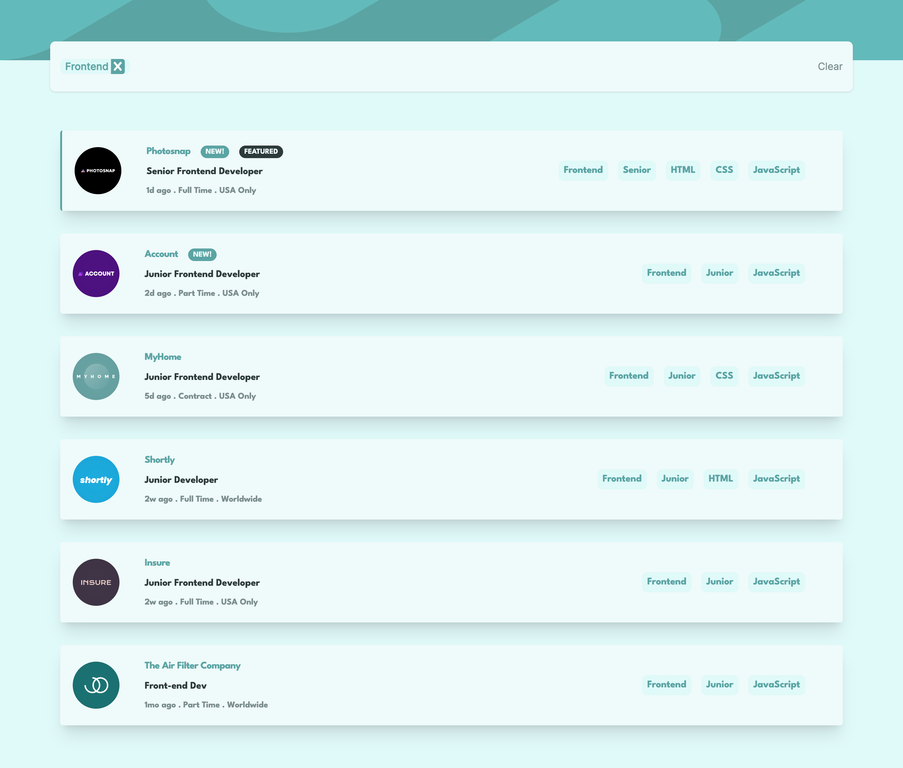
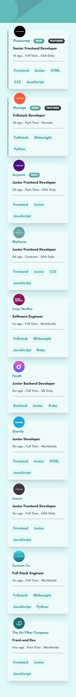

# Job Search Web Application 🚀

A modern and responsive job search platform built using **React**, **Tailwind CSS**, and **Redux Toolkit**. This application allows users to efficiently browse, filter, and explore job opportunities based on their preferences.

## Table of Contents

- [Features](#features)
- [Technologies Used](#technologies-used)
- [Installation](#installation)
- [Usage](#usage)
- [Screenshots](#screenshots)
- [Live Demo](#live-demo)
- [Acknowledgments](#acknowledgments)

---

## Features ✨

- **Responsive Design**: Fully optimized for all devices (desktop and mobile).
- **Advanced Filtering**: Filter jobs by category, experience level, and location.
- **Company Details**: View detailed information about companies, including logos and job descriptions.
- **Fast Performance**: Built with React and Redux for a seamless user experience.
- **Clean UI/UX**: A visually appealing and user-friendly interface designed with Tailwind CSS.

---

## Technologies Used 💻

- **Frontend**: React, Tailwind CSS
- **State Management**: Redux Toolkit
- **Development Tools**: Vite, ESLint, Prettier

---

## Installation 🛠️

1. Clone the repository:
   ```bash
   git clone https://github.com/Stevesadr/joblistings.git
   ```
2. Navigate to the project directory:
   ```
    cd joblisting
   ```
3. Install dependencies:
   ```
    npm install
   ```
4. Run the app:
   ```
   npm run dev
   ```

## Usage 🚀

After running the app locally, you can access it at http://localhost:5173 (or the port specified in your environment). Use the filtering options to explore job opportunities based on your preferences.

## Screenshots 📸

### Desktop View



### Mobile View



## Live Demo 🌐

👉 Check out the live demo of this project:

## Acknowledgments 🙌

This project is based on a challenge from [Frontend Mentor](https://www.frontendmentor.io/).  
The original design idea belongs to them, and I have built it using React and Tailwind CSS.

# 🌟 Show Your Support!

If you like this project, please ⭐️ the repository to help it grow!
